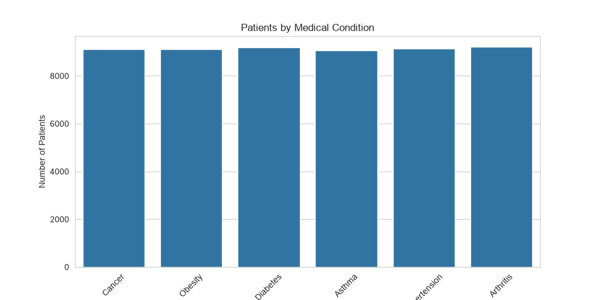
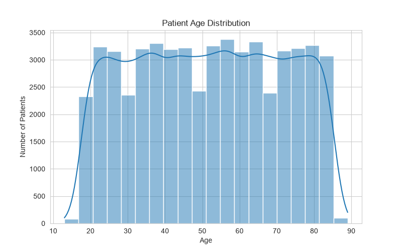
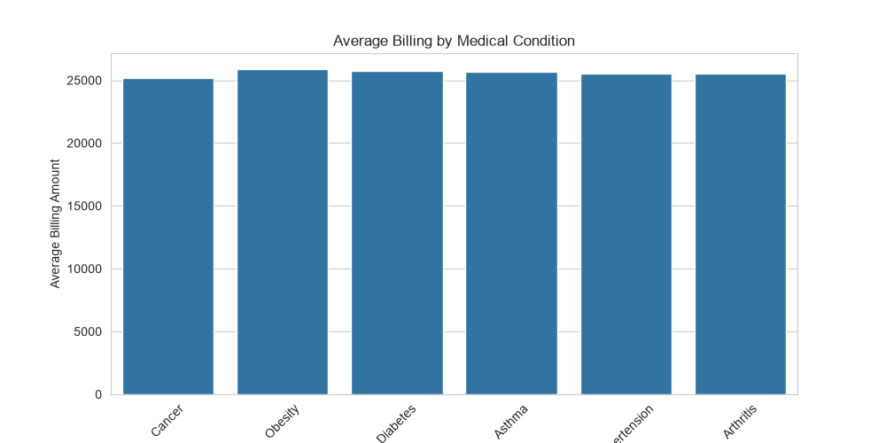
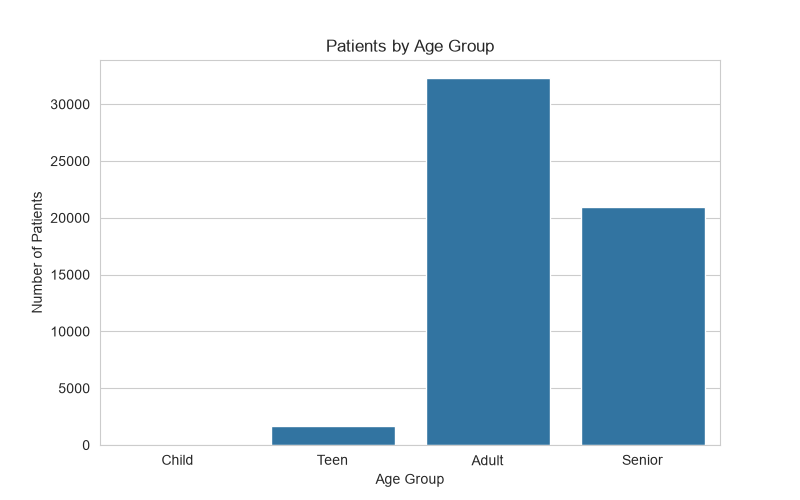
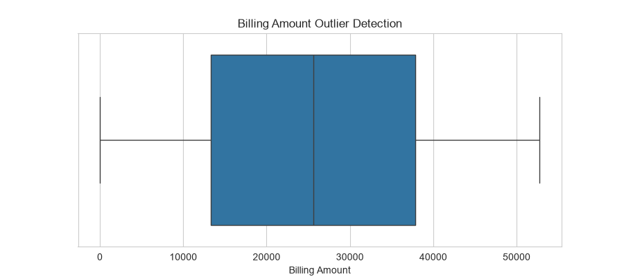
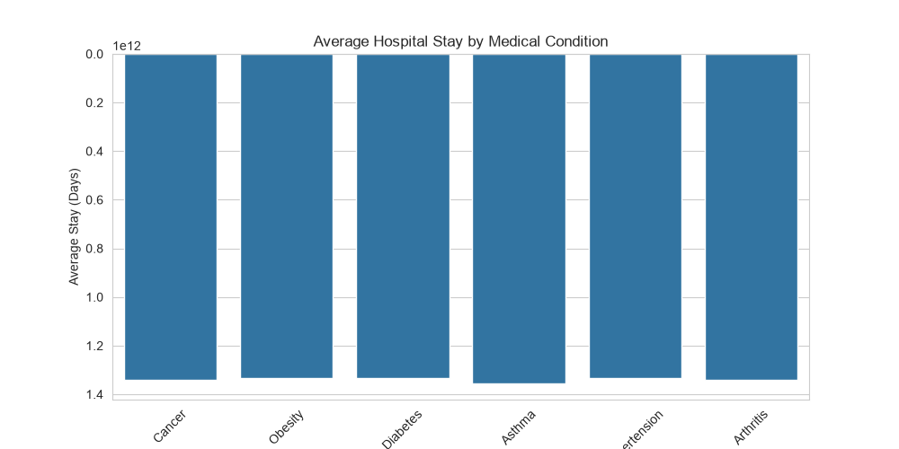
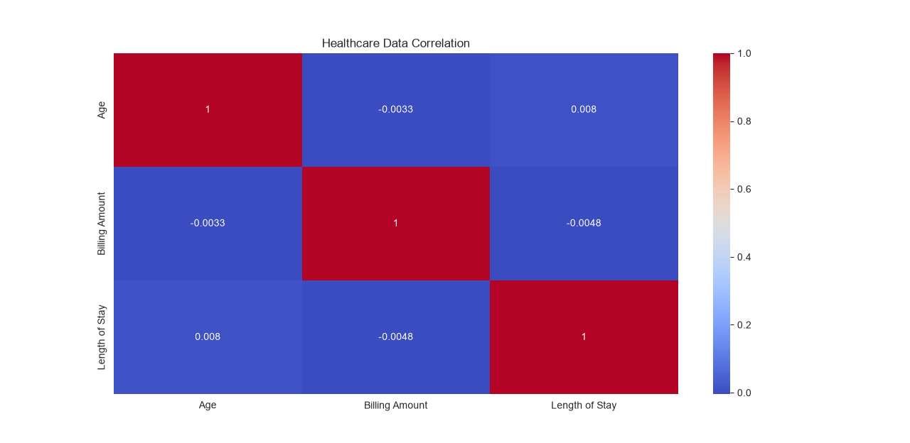

# 🏥 Healthcare Data Analysis

## 📌 Project Overview
This project explores a healthcare dataset containing 55,000+ records using Python. The goal is to clean, analyze, and visualize patient data to discover useful patterns and insights.

## 🛠️ Technologies Used
- Python
- Pandas
- NumPy
- Matplotlib
- Seaborn

## 📊 Project Tasks
- Data inspection and exploration
- Handling missing values
- Removing duplicate records
- Data cleaning and preprocessing
- Filtering patient records
- Feature engineering
- GroupBy and aggregation
- Statistical analysis
- Data visualization

## 📈 Visualizations
- Patients by Medical Condition
- Patient Age Distribution
- Average Billing by Medical Condition
- Patients by Age Group
- Billing Amount Outlier Detection
- Average Hospital Stay by Medical Condition
- Correlation Heatmap

## 🎯 Key Learning Outcomes
- Practiced Exploratory Data Analysis (EDA)
- Improved data cleaning skills
- Learned data manipulation using Pandas
- Created visualizations using Matplotlib and Seaborn
- Practiced extracting insights from real-world-style datasets

## 👨‍💻 Author
Data Science Student | Aspiring Data Scientist

## 🚀 Project Status
Completed

## Project Visualizations

### 1. Patients by Medical Condition

### 2. Patient Age Distribution

### 3. Average Billing by Medical Condition

### 4. Patients by Age Group

### 5. Billing Amount Outlier Detection

### 6. Average Hospital Stay by Medical Condition

### 7. Correlation Heatmap

